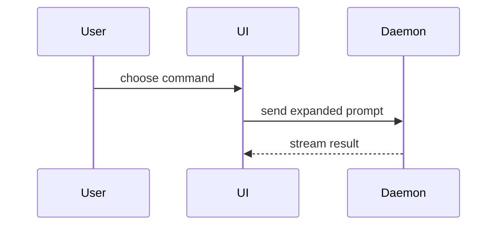

# Visual guidance

Help the user understand the current topic of conversation visually. Skip the preamble and keep prose brief. Pick the smallest view that makes the key point clear.

- Show logic or an algorithm as pseudocode:

```text
on(save)
  if content is unchanged
    return cached result
  write new content
  return fresh result
```

- Show runtime control flow as a call tree:

```text
submitForm
  createSession
    persistPrompt
    launchAgent
  navigateToSession
```

- Show UI structure as a component tree, including state and module boundaries that matter:

```tsx
<SessionPage> (apps/example/src/routes/session.tsx)
  useSessionEvents()
  <SessionToolbar>
    <RunSkillButton> (packages/ui)
```

- Show file responsibility or a broad refactor as a shallow file tree:

```text
src/
├── commands/       # parses user actions
├── sessions/       # owns session state
└── transport/      # sends API requests
```

- Show component interaction, control flow, or data flow with Mermaid. Aim for readable, moderately compact diagrams—not the narrowest possible. Rendering may disappear when the window is narrower than the diagram, but do not strip useful detail or split related steps preemptively. Use sequence diagrams for order and interaction, and `flowchart TD` when it clarifies structure. Use `mermaid_check` when available to preflight the full source with Pi's renderer, and revise excessive width or warnings before posting. Leave some breathing room, and treat preflight as a prediction, not observed screen feedback. If actual rendering differs, ask for screen feedback and recheck the current width. Split only when width actually becomes a problem:



- Use `diff` when the point is what changes and the surrounding shape already exists. Match the diff shape to the topic.

For a component change:

```diff
 <SessionPage>
   useSessionEvents()
   <SessionToolbar>
+    <RunSkillButton />
   <SessionTimeline>
+    <SkillResultCard />
```

For a file-layout change:

```diff
 src/
 ├── commands/
+│   └── show-me.ts       # expands the slash command
 ├── sessions/
-└── transport.ts
+└── transport/
+    ├── client.ts
+    └── stream.ts
```

For a call-tree or call-stack change:

```diff
 submitForm
   createSession
     persistPrompt
+    expandSkillMention
     launchAgent
-  navigateToSession
+  navigateToSession
+    subscribeToEvents
```

For a state or control-flow change:

```diff
 on(save)
-  write content
+  if content is unchanged
+    return cached result
+  write new content
+  invalidate cache
```

- Show the whole block when most of it is new, when omitted context would hide ownership or order, or when the user needs a copyable target shape:

```ts
function expandSkill(command: string): string {
  const skillName = command.slice(1)
  return `use the ${skillName} skill`
}
```

- For a visual UI, layout, state comparison, or concept too dense for Mermaid, offer one focused HTML artifact and create it only when the user requests it. Match the product's colors, type, spacing, and components; use real labels and data; support desktop and mobile; then save it in the resolved task directory and link to the local file:

[Visual explanation](show-me-description.html)

Show Markdown visuals directly in the chat response by default, using fenced `mermaid` blocks for inline diagrams. Save files only when requested. A brief text explanation may accompany the diagram, but must not replace it with a file link. For requested HTML artifacts, use self-contained HTML, inline CSS/SVG, and no remote dependencies by default. Provide the absolute path for opening in a browser; do not claim it has been rendered.

- Place each visual next to the short text it supports. Keep only the calls, files, props, states, and boundaries needed to answer the user's current question.
